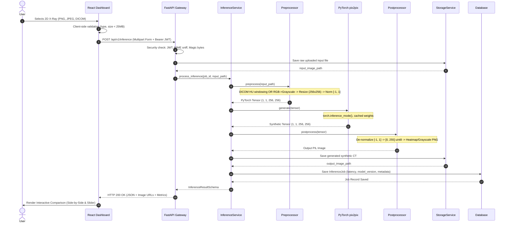

# System Architecture Document

## 1. System Overview

The **X-Ray to CT Image Translation System** is a modular, research-oriented platform engineered to translate 2D planar projection radiographs (X-rays) into synthetic 2D cross-sectional Computed Tomography (CT)-like representations using conditional generative adversarial networks (pix2pix).

```mermaid
flowchart TD
    subgraph Client ["Client Presentation Layer (React 18 + Vite + Tailwind)"]
        UI[Medical Research Dashboard]
        Viewer[Side-by-Side & Slider Comparison Viewer]
        Uploader[Drag-and-Drop Image Uploader]
    end

    subgraph Gateway ["API & Application Layer (FastAPI)"]
        AuthRoute[/api/v1/auth]
        InfRoute[/api/v1/inference]
        ModelRoute[/api/v1/models]
        HealthRoute[/api/v1/health]
        Security[JWT / Rate Limiter / MIME Validator]
    end

    subgraph Services ["Service Layer"]
        InferenceSvc[Inference Service]
        PreprocessSvc[Medical Preprocessing Pipeline]
        PostprocessSvc[Postprocessing Pipeline]
        StorageSvc[Storage Service Abstraction]
    end

    subgraph ML ["Machine Learning Inference Core"]
        Registry[Model Registry & Cache]
        Engine[PyTorch Inference Engine]
        Model[pix2pix U-Net Generator v1]
    end

    subgraph Data ["Persistence & Cache"]
        DB[(PostgreSQL / SQLite Database)]
        LocalStorage[(Local File Storage / S3)]
        RedisCache[(Redis Queue & Cache)]
    end

    UI --> Security
    Security --> AuthRoute
    Security --> InfRoute
    Security --> ModelRoute
    Security --> HealthRoute

    InfRoute --> InferenceSvc
    InferenceSvc --> PreprocessSvc
    PreprocessSvc --> Engine
    Registry --> Engine
    Engine --> Model
    Engine --> PostprocessSvc
    PostprocessSvc --> StorageSvc
    StorageSvc --> LocalStorage
    InferenceSvc --> DB
    AuthRoute --> DB
    InferenceSvc -.-> RedisCache
```

---

## 2. Core Architectural Principles

### 2.1 Separation of Concerns
The architecture strictly decouples:
- **Presentation Layer**: React 18 SPA (Vanilla JavaScript, zero TypeScript overhead, fast iteration).
- **REST Interface**: FastAPI application containing purely route orchestration and schema validation.
- **Business Services**: Stateless application services (`InferenceService`, `StorageService`).
- **ML Inference Engine**: Isolated PyTorch modules decoupled from web frameworks (`BaseTranslationModel`, `ModelLoader`, `InferenceEngine`).
- **Data Persistence**: SQLAlchemy 2.0 ORM agnostic to SQLite (local dev) and PostgreSQL (production).

### 2.2 Medical & Research Safety Boundary
Because translating a 2D projection into a volumetric slice is an ill-posed mathematical inverse problem (loss of depth dimension and attenuation integration along ray paths), the system is explicitly architected as a **research visualization tool**:
- Strict disclaimer enforcement at UI, API schema, and output metadata levels.
- Non-diagnostic watermarking and research-only metadata embedded in all exported assets.

---

## 3. Detailed Data Flow



---

## 4. Component Technical Specifications

| Component | Technology | Rationale & Architectural Decisions |
| :--- | :--- | :--- |
| **Frontend UI** | React 18, Vite, Tailwind CSS | High performance, lightweight bundle, zero TypeScript compilation issues, rich interactive CSS transitions for sliders and medical zoom/pan. |
| **Backend API** | FastAPI, Python 3.13, Pydantic v2 | High asynchronous throughput, automatic OpenAPI/Swagger documentation, strict type validation, fast JSON serialization. |
| **ML Framework** | PyTorch 2.x | Standard in medical imaging research, native support for U-Net skip-connections and PatchGAN conditioning. |
| **Translation Model** | pix2pix (Conditional GAN) | Paired image-to-image translation with adversarial patch loss and L1 pixel reconstruction loss. |
| **Database** | PostgreSQL 16 / SQLite 3 | Robust ACID transactional persistence with SQLite zero-configuration local fallback. |
| **Storage** | Pluggable `StorageService` | Abstract interface supporting Local Filesystem for development and S3/MinIO for cloud deployment without changing business logic. |
| **Cache & Tasks** | Redis 7 | Optional caching for model metadata and asynchronous job queueing. |

---

## 5. Security & Threat Modeling

1. **Untrusted File Ingestion**:
   - Files are validated against magic bytes (preventing executable renaming attacks).
   - Maximum upload size constrained to 25MB.
   - Files are renamed to cryptographic UUIDs before persistence to prevent directory traversal (`../../etc/passwd`).
2. **Authentication & Authorization**:
   - Access tokens signed using HMAC-SHA256 (JWT).
   - Passwords hashed using `bcrypt` with adaptive salt rounds.
   - Role-Based Access Control (`USER`, `ADMIN`) protecting model management endpoints.
3. **PHI / HIPAA Compliance Consideration**:
   - Patient de-identification pipeline strips all DICOM metadata tags (Patient Name, ID, Birth Date, Institution) prior to model intake and storage.
