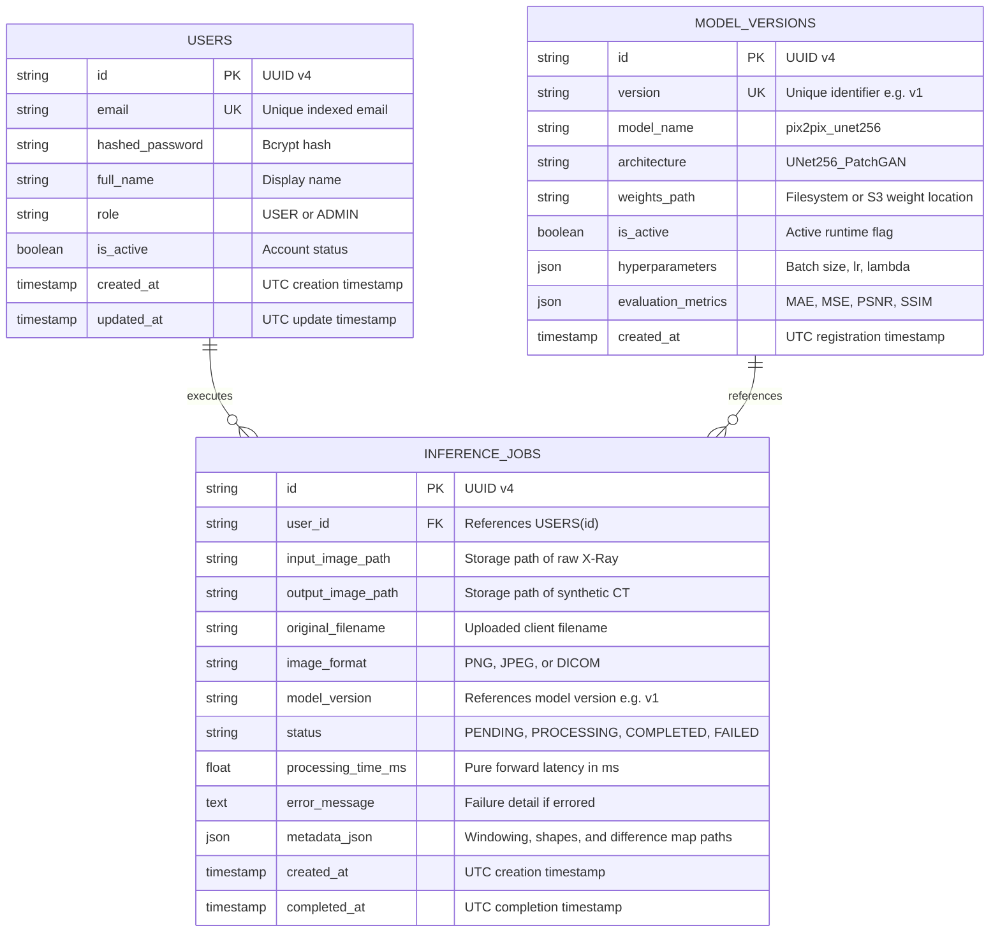

# Database Architecture & Entity Relationships

The data layer is built on **SQLAlchemy 2.0 Async ORM**, offering dual-engine portability:
- **PostgreSQL 16** with `asyncpg` for multi-worker containerized production.
- **SQLite 3** with `aiosqlite` for zero-configuration, self-contained local testing.

---

## 1. Entity-Relationship Diagram

---

## 2. Indexing Strategy & Query Optimization

| Table | Column | Index Type | Optimization Goal |
| :--- | :--- | :--- | :--- |
| `users` | `email` | `UNIQUE B-Tree` | $O(1)$ fast lookup during login authentication without full table scan. |
| `inference_jobs` | `user_id` | `B-Tree` | Accelerates paginated user history queries (`WHERE user_id = ? ORDER BY created_at DESC`). |
| `inference_jobs` | `status` | `B-Tree` | Optimizes admin telemetry queries counting completed vs failed jobs. |
| `inference_jobs` | `created_at` | `B-Tree (Desc)` | Fast chronological pagination and cursor sorting. |
| `model_versions` | `version` | `UNIQUE B-Tree` | Ensures zero ambiguity during model loading and caching. |

---

## 3. Data Integrity & Cascade Rules

1. **User Deletion**:
   - `ondelete="CASCADE"` is configured on `InferenceJob.user_id`. When a user account is deleted, associated job records are automatically pruned.
2. **Password Security**:
   - Plaintext passwords are never persisted. Passwords are encrypted using `bcrypt` with adaptive salt rounds before database submission.
3. **PHI De-identification**:
   - DICOM records strip all HIPAA identifiers (names, MRNs, dates of birth) prior to storing metadata in `metadata_json`.
