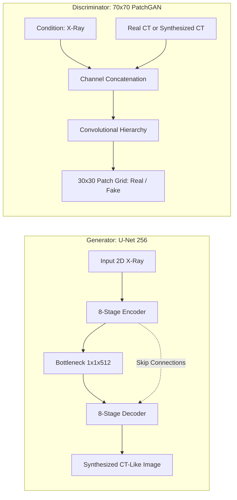

# Machine Learning Translation Pipeline & pix2pix Architecture

## 1. Machine Learning Architecture Overview

The system models the radiologic projection inversion problem as a paired image-to-image translation task using a **Conditional Generative Adversarial Network (cGAN)** based on the **pix2pix** paradigm (Isola et al., 2017).

---

## 2. Generator: U-Net with Skip Connections

Planar X-rays contain strong anatomical silhouettes of bone, mediastinum, and diaphragm that directly outline cross-sectional boundaries. A pure downsampling-upsampling autoencoder causes bottleneck information loss, yielding blurry, smeared synthetic slices.

### Skip Connections
The U-Net architecture connects each encoder stage $i$ directly to decoder stage $n - i$ via tensor concatenation:
$$\mathbf{h}_{\text{decoder}}^{(n-i)} = [\text{Upsample}(\mathbf{h}_{\text{decoder}}^{(n-i-1)}) \parallel \mathbf{h}_{\text{encoder}}^{(i)}]$$

This allows micro-structures (rib cortex boundaries, aortic arch curves, spinal processes) to bypass the low-dimensional $1 \times 1 \times 512$ bottleneck and directly reconstruct crisp anatomical margins.

---

## 3. Discriminator: 70×70 PatchGAN

Instead of penalizing the entire image with a single scalar output ($0$ or $1$), the PatchGAN discriminator convolves across the image with a **$70 \times 70$ effective receptive field**, evaluating whether each local patch is real or synthetic.

### Why PatchGAN?
- Low frequencies (global organ layout, thoracic oval boundary) are handled by the $\mathcal{L}_{L1}$ reconstruction loss.
- High frequencies (trabecular texture, soft-tissue boundaries, noise characteristics) are enforced by PatchGAN.
- Requires fewer parameters than full-image discriminators and runs efficiently on arbitrary input dimensions.

---

## 4. Objective Formulation

The objective function combines conditional adversarial loss with an $L_1$ pixel reconstruction penalty:

$$\mathcal{L}_{\text{cGAN}}(G, D) = \mathbb{E}_{X, Y}[\log D(X, Y)] + \mathbb{E}_{X}[\log(1 - D(X, G(X)))]$$

$$\mathcal{L}_{L_1}(G) = \mathbb{E}_{X, Y}[\|Y - G(X)\|_1]$$

$$\mathcal{L}_{\text{Total}} = \mathcal{L}_{\text{cGAN}} + \lambda \mathcal{L}_{L_1}$$

In our production configuration:
- $\lambda = 100.0$: Prioritizes faithful anatomical correspondence over speculative hallucination.
- Least Squares GAN (LSGAN via Mean Squared Error) is employed instead of negative log likelihood to stabilize gradient backpropagation and prevent vanishing gradients.

---

## 5. Technical Interview Deep-Dive

### Q1: Why use pix2pix instead of standard CycleGAN?
**Answer**:
When paired training pairs $(X_{\text{xray}}, Y_{\text{ct}})$ are available (e.g., from Digitally Reconstructed Radiographs synthesized from CT volumes or calibrated bi-planar acquisitions), conditional paired GANs are mathematically superior. CycleGAN relies on cycle consistency without spatial conditioning, which frequently suffers from geometric hallucinations and anatomical drifting—unacceptable in biomedical research.

### Q2: Why L1 loss instead of L2 (MSE) in image translation?
**Answer**:
L2 loss minimizes squared errors, which mathematically encourages the network to predict the conditional mean of all possible realizations:
$$\arg\min_{\hat{y}} \mathbb{E}[(y - \hat{y})^2] = \mathbb{E}[y]$$
In ill-posed problems with multiple possible depth states, this conditional mean results in blurry, washed-out images. $L_1$ loss encourages the conditional median, preserving sharp step boundaries:
$$\arg\min_{\hat{y}} \mathbb{E}[|y - \hat{y}|] = \text{median}(y)$$

### Q3: What is the fundamental physical limitation of 2D X-Ray to 3D CT translation?
**Answer**:
Planar radiography is a forward projection of attenuation line integrals:
$$I(u, v) = I_0 \exp\left(-\int_L \mu(x, y, z) \, dl\right)$$
Information along the line $L$ is physically compressed into a single scalar. Reconstructing the cross-section $\mu(x, y)$ from a single projection is an ill-posed inverse problem with infinite null-space solutions. The neural network cannot recover unprojected volumetric reality; it infers a learned statistical prior. Hence, all outputs must be labeled **non-clinical research representations**.
