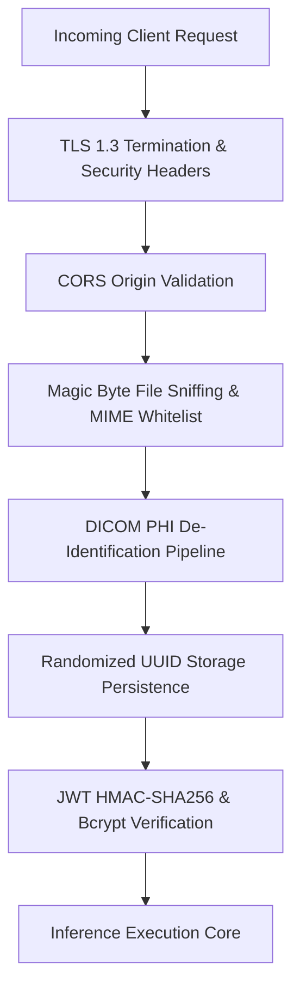

# Security Architecture & Threat Defense Model

## 1. Defense-in-Depth Security Layers

The system enforces multi-layered defense to safeguard sensitive medical infrastructure, prevent arbitrary code execution, and eliminate Protected Health Information (PHI) leakage.

---

## 2. File Upload Hardening

All uploaded files are treated as hostile, untrusted inputs:

1. **Anti-Spoofing Magic Byte Inspection**:
   - Files are rejected if the binary payload does not begin with authorized magic headers:
     - PNG: `\x89PNG\r\n\x1a\n`
     - JPEG: `\xff\xd8\xff`
     - DICOM: `DICM` at byte offset 128
   - Extension renaming attacks (e.g., `malware.exe` renamed to `scan.png`) are thwarted before any file reaches disk.
2. **Deterministic Cryptographic Renaming**:
   - User-supplied filenames are never used for filesystem paths. Every stored asset is written as a random UUID: `<subfolder>/<uuid4_hex>.<clean_ext>` to eliminate directory traversal attacks (`../../etc/passwd`).
3. **Payload Size & Dimension Caps**:
   - Files exceeding 25 MB or dimensions exceeding 4096×4096 are rejected at ingestion.
4. **Execution Prevention**:
   - Stored file directories are served with `X-Content-Type-Options: nosniff` headers and execute permissions are disabled.

---

## 3. Medical Data Privacy & HIPAA Alignment

1. **Aggressive Metadata Stripping**:
   - In accordance with the HIPAA Privacy Rule Safe Harbor method (45 CFR § 164.514(b)(2)), all incoming DICOM files have sensitive tags stripped prior to saving or inference:
     - Patient Name, ID, Age, Date of Birth, Address, Medical Record Numbers, Institution, Referring Physician.
2. **Pure Attenuation Processing**:
   - The ML model operates strictly on normalized attenuation arrays without demographic or patient metadata inputs.

---

## 4. Authentication & Access Control

1. **Password Hashing**:
   - Pure `bcrypt` hashing with salt work factor of 12 rounds. Plaintext passwords are never logged or stored.
2. **JSON Web Tokens (JWT)**:
   - Stateless HMAC-SHA256 signed access tokens with configurable expiration (default 24 hours).
3. **Role-Based Access Control (RBAC)**:
   - Distinct authorization roles (`USER`, `ADMIN`).
   - Administrative endpoints (`/api/v1/models/admin/stats`) require strict token privilege verification.
